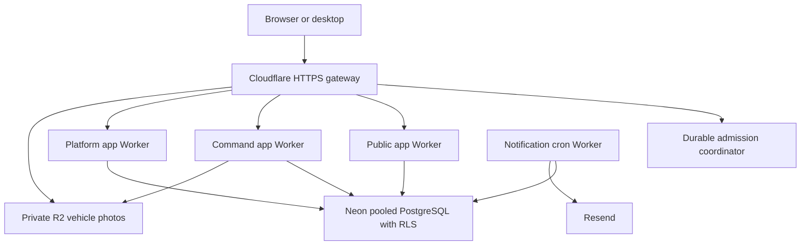

# Cloudflare + Neon deployment and cutover

This change prepares the existing Automobile Engine for Cloudflare Workers, private R2 buckets, shared Neon PostgreSQL and Resend notifications. It does not provision live accounts, migrate existing records, verify Search Console, or change live DNS without authenticated account access. The checked-in deployment config starts as a browse-only reference deployment.

## Architecture



The apps retain `/`, `/command`, and `/platform` under one HTTPS origin. Staff and public services have no workers.dev or version-preview URLs, preventing an internet-facing bypass around the gateway. Only the gateway receives the custom domain. Keep the domain in the same Cloudflare account. Public car photos use the gateway `/media/` path; no R2 public bucket is needed. Customer files and identity documents must not use this public photo route.

Cloudflare distributes execution across its network. A separately billed multi-origin Load Balancing product is not necessary for this initial serverless deployment. This is not database failover or cross-provider disaster recovery.

## Controls and practical limits

| Area | Implemented control | Limit / operating detail |
|---|---|---|
| Gateway traffic | Persistent atomic per-IP counters | 120 dynamic requests per minute; static assets and photo reads bypass the counter |
| Lead/event writes | Durable per-IP, per-tenant scope limiter | Existing route budgets retained; leads 12 per minute; missing bindings fail closed |
| Concurrency | Durable gateway leases | 24 concurrent dynamic requests across the deployment; capacity exhaustion returns 503 + Retry-After |
| SQL connections | Request-bound Neon WebSocket pool | One connection per tenant transaction, closed in the originating request; Neon pooler manages backend connections |
| SQL timeouts | Verified TLS + connection/statement limits | 5-second connection deadline; 15-second SQL deadline |
| Database authorization | `vandlabs_app` + FORCE RLS | No superuser or BYPASSRLS; transaction-local tenant context; no session-level tenant state |
| Staff identity | Signed OIDC API JWT + server-owned permissions | Issuer, API audience, algorithm, expiry and issued-at verified; database registry checked on requests |
| Staff sessions | PKCE + encrypted refresh cookie | Secure, HttpOnly, SameSite; exact origin check for mutations; credentials never in browser storage |
| Writes | Existing optimistic versions and transactional audit | Stale edits conflict; confirmed sales stay atomic |
| Storage | Authenticated capability-checked photo upload | WebP/AVIF only, 4 MB limit, content signature check, tenant-scoped immutable keys |
| Caching | R2 Next data cache + immutable static and photo cache | Published inventory refreshes after 30 seconds; staff/API/cookie-bearing responses remain private/no-store |
| Email | Transactional outbox + scheduled retries | Ten claims per run, sequential delivery, provider idempotency key; no customer contact data in emails |
| Error logging | Cloudflare observability + sanitized JSON events | Request IDs; no raw provider errors, tokens, connection strings, lead names or phones |
| Release | GitHub CI + serialized deployment workflow | Explicit deployment dispatch on main through `cloudflare-production` environment |

The concurrency ceiling bounds gateway requests, not the total number of SQL transactions inside a request. Tune database and request limits together after measuring actual workload. Lease expiry recovers abandoned requests after 60 seconds. The single global coordinator deliberately prioritizes a small predictable launch capacity; benchmark before increasing it. Request and storage limits reduce spend but do not guarantee a fixed bill.

The OpenNext adapter warns that Next 15 Node.js middleware support on Workers is experimental. The existing middleware guards are retained, as are authorization checks inside the API and data layer. Do not promote shared production traffic until real Workers tests confirm anonymous access rejection, staff sign-in, refresh, permissions and revocation. The native OIDC changes also need Windows/macOS installer acceptance.

## Account setup and cost

Use Workers Paid for the SSR applications and configured CPU ceilings. Cloudflare's published Workers subscription baseline is USD 5/month; usage and other services are additional. R2 Standard includes a free storage/operation allowance (10 GB-month storage, 1 million Class A and 10 million Class B operations at the time checked). Resend Free lists 3,000 emails/month with a daily limit of 100. Neon has a free plan; confirm the allowances shown in this account before launching. Authentication provider charges, taxes and domain renewal are separate. No subscription was purchased by this change.

Official references, checked 2026-10-12:
- https://developers.cloudflare.com/workers/platform/pricing/
- https://developers.cloudflare.com/r2/pricing/
- https://neon.com/pricing
- https://resend.com/pricing
- https://opennext.js.org/cloudflare/get-started
- https://developers.cloudflare.com/workers/databases/third-party-integrations/neon/

Choose the Neon region closest to the initial customers and enable scale-to-zero where appropriate. Configure available usage alerts in Cloudflare, Neon and Resend. Review Workers CPU, R2 operations, outbox backlog and Neon compute weekly. Enable R2 cache bucket lifecycle expiration after an appropriate retention interval; never apply that policy to vehicle photos. Decide recovery retention and test a restore before live dealer data is accepted.

## Database provisioning and existing data

1. Create a Neon project and a separate staging branch. Admin URLs stay in secure provisioning configuration, not Worker runtime.
2. Set `MIGRATION_DATABASE_URL` to the direct admin connection. Run `pnpm db:migrate` (migration 0006 adds the email outbox).
3. Set `APPLICATION_DATABASE_PASSWORD` through secure environment input and run `pnpm db:provision-role`. This creates the non-bypass `vandlabs_app` role without AWS Secrets Manager. Provision the tenant with the existing validated provisioning command; do not seed reference vehicles into a live dealership.
4. Copy the pooled `vandlabs_app` URL into `DATABASE_URL` for the three Workers and notification job. Use the same production `TENANT_CONFIG_JSON` and identifiers across all apps.
5. If a real source database already exists, take a verified backup, rehearse a restore into staging and compare counts, tenant IDs, availability, leads, appointments, tasks, sales and audit history. Rehearse R2 photo transfer and URL mapping. Freeze source writes for the final transfer, verify totals and switch only after end-to-end acceptance. Do not delete source infrastructure until the agreed recovery window ends.

Migration credentials never go into the app Workers. The runtime role is checked on every transaction. `DATA_MODE=neon` uses the shared PostgreSQL store; the legacy Aurora mode remains supported for recovery.

## Identity, domain and email

Configure an OIDC provider that issues RS256/ES256 access JWTs for a dedicated API audience. Browser and native public OAuth clients use PKCE; their client IDs must differ from the API audience. OAuth authorization receives the API `audience`; optionally set `OIDC_RESOURCE` for a provider that needs the standard resource parameter. Configure the exact callback paths `/command/auth/callback` and `/platform/auth/callback`, and the native loopback callback `http://localhost:43821/callback`. The current native implementation requires the authorize/token/revoke endpoints to share the configured HTTPS sign-in origin. Keep token lifetimes at most one hour. Provision explicit staff scopes and a narrowly scoped platform bootstrap account.

Cognito compatibility remains available, but the default shared Cloudflare workflow uses OIDC. A database provider alone does not supply this configured identity system. Selecting, registering and testing the provider is a remaining account setup step.

Verify the sending domain in Resend and install its actual DNS records. Set `NOTIFICATION_FROM` and `NOTIFICATION_TO` to an authorized dealership mailbox. Set `NOTIFICATIONS_ENABLED=true` only after migration 0006 and delivery testing. Email contains a workspace reference, not customer contact information. Failed items remain in the outbox; records older than 23 hours stop automatic retries to stay inside the provider's idempotency window. Investigate exhausted/expired items and replay only after checking delivery history. Multi-recipient messages count toward provider usage; start with one mailbox.

## Deployment

Put secrets in the GitHub `cloudflare-production` environment. `.env.example` lists the required settings. The workflow has no embedded credentials. Configure `CF_PUBLIC_ORIGIN` and `CLOUDFLARE_ACCOUNT_ID` as environment variables. Build-time public branding/SEO configuration must match the runtime domain.

```sh
pnpm install --frozen-lockfile
pnpm db:migrate
pnpm db:provision-role
pnpm cf:configure
pnpm cf:build
pnpm cf:deploy
```

The configure/deploy commands read their environment; set `CF_SHARED_DATA=true` for shared data or leave it unset for the browse-only demo. Shared mode validates a real HTTPS origin, pooled application role, tenant metadata and OIDC settings. The deployment doctor probes TLS, RLS and required tables before deployment. The deploy script creates missing private R2 buckets, deploys the admission coordinator, deploys apps, injects runtime secrets through stdin, then deploys the gateway and optional notification cron. Account billing/R2 enablement and the scoped deployment token must already be available. A production deployment must use the production domain; test with a separate staging configuration and names first. Checked-in worker names currently describe one deployment, not simultaneous isolated production/staging stacks.

Native OAuth configuration fields are additive; the legacy `cognitoDomain` field name is retained for compatibility with existing installers. New OIDC installers should be built and tested before replacing active Cognito-only installers.

## Acceptance, monitoring and recovery

Before DNS cutover, verify on real Cloudflare Workers:
- `/api/health`, robots.txt, sitemap.xml, PNG social image, public inventory and a vehicle URL.
- `/command` and `/platform` reject anonymous, forged headers and wrong roles; APIs reject cross-tenant IDs.
- Sign-in, refresh, sign-out and database permission revocation; native workspace discovery and sign-in.
- Public enquiry appears once in the staff workspace, follow-up runs, appointment and sale update the shared records; no stale edit overwrites.
- Rate limit returns 429; a controlled concurrent burst returns bounded 503s; missing protection fails closed.
- Approved staff can upload a compressed photo; unauthenticated uploads fail; immutable photo URLs work.
- A new lead creates one outbox row; cron sends once and records delivery; temporary failures retry without exposing provider details.
- Browser layouts at 320/375/390/768/1024 px, keyboard navigation, heading structure, console and network errors.
- Lighthouse after deployment, then Search Console field Core Web Vitals after sufficient traffic. A build result is not a field Core Web Vitals score.

Use Cloudflare Workers error/CPU/request dashboards and structured request IDs. Add external uptime checks to the public health URL; use protected readiness APIs for database health. Alert on error ratio, retry backlog, Neon connection/compute pressure and R2 usage. No account alert or uptime check was created in this unauthenticated session. Keep previous Worker versions and a tested database backup. Rollback application versions and route to the prior host if acceptance fails; do not roll back a database by deleting records.

See `SEO_AND_BACKLINK_PLAN.md` for Search Console verification and the content/link acquisition process.
